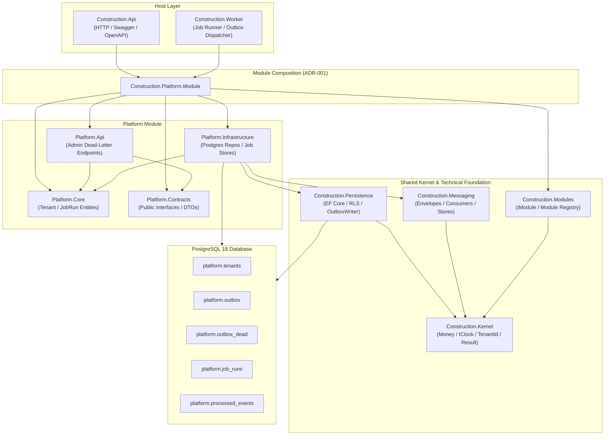
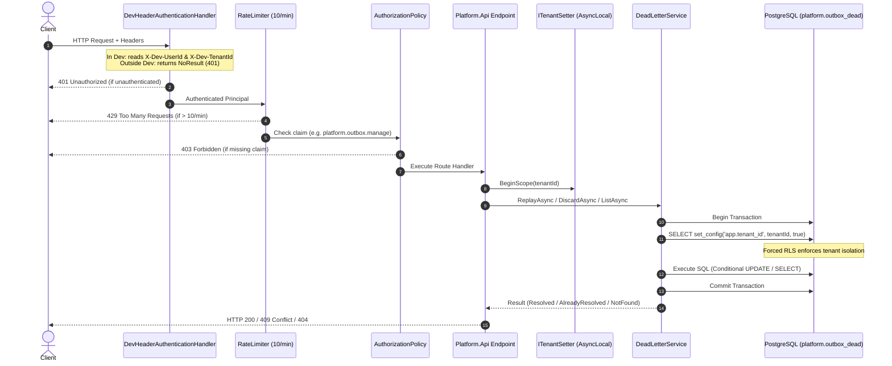
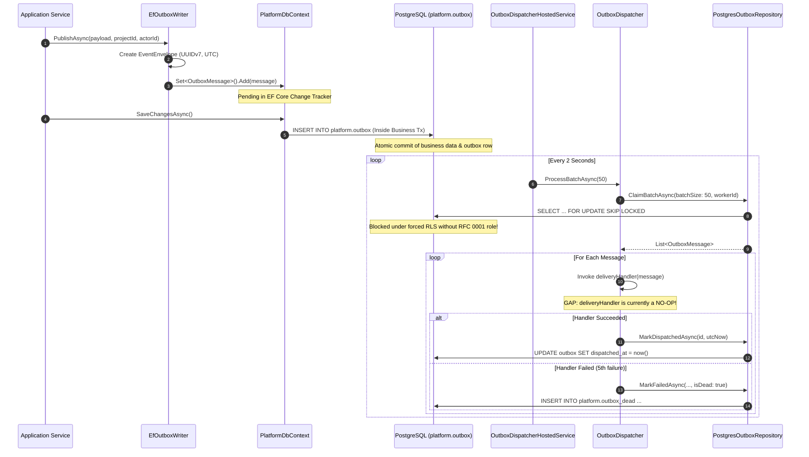
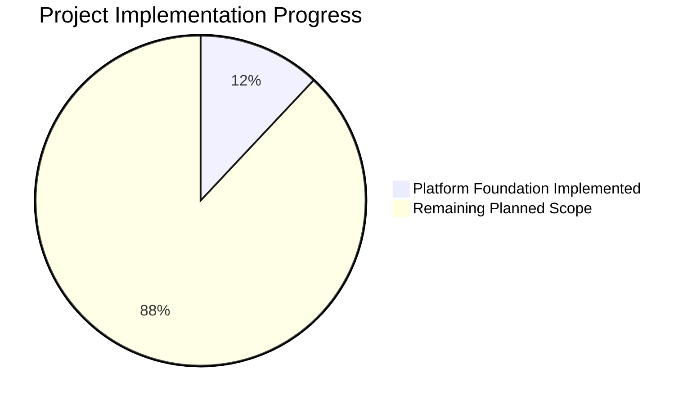
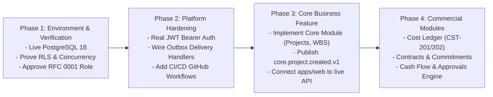

# Bonyan / Construction Connect — Comprehensive Planning vs. Implementation Audit

**Audit Date:** 2026-11-14  
**Auditor:** Antigravity Engineering Audit  
**Target Solution:** Bonyan (`backend/Construction.sln`, `apps/web`, `apps/mobile`)  
**Commit Audited:** `5571c68` (`HEAD -> main`, `origin/main`)  
**Audit Scope:** Full Project Audit (Planning vs. Implementation, Architecture, Code Quality, Dependencies, PLT-201–PLT-204, Production Readiness, Roadmap)

---

## Executive Summary

| Audit Dimension | Evaluation | Details |
|---|---|---|
| **Notion Planning Alignment** | **12%** | Foundational scaffolding and Platform infrastructure partially implemented; 13 out of 14 planned business modules not started. |
| **Code Quality (Platform & Kernel)** | **Very High (8.5/10)** | .NET 10 modern patterns, strict nullable reference types, zero warnings under `-warnaserror`, robust encapsulation in Kernel/Messaging. |
| **Clean Code & SOLID** | **Strong (with isolated exceptions)** | Domain isolation strictly maintained in Kernel and Platform.Core. Infrastructure leakage and DI service lifetime issues noted in Worker host. |
| **Architectural Drift** | **Moderate** | Introduction of 5th project (`X.Module`) per module (ADR-001); hand-written job runner in place of Hangfire (ADR-002); single dispatch outbox vs. spec 01 fan-out. |
| **PLT-201 to PLT-204 Integration** | **Functionally Disconnected** | Code paths compile and pass unit tests with fakes, but Worker dispatcher executes no-op handler `(_, _) => Task.CompletedTask`; PostgreSQL RLS blocks cross-tenant claims without unapproved DB role (RFC 0001). |
| **Production Readiness** | **NOT READY (15%)** | No real authentication/identity provider; zero CI/CD pipelines; zero containerization/Dockerfiles for apps; unverified PostgreSQL RLS; web frontend runs entirely on static mock data. |

### Direct Answers to Key Questions

1. **How closely does the current implementation match the Notion planning?**  
   The current codebase represents approximately **10% to 15%** of the total planned system described across Notion specs `00` through `20`. While the architectural skeleton, foundational Shared libraries (`Kernel`, `Messaging`, `Persistence`, `Modules`), and portions of the `Platform` module (`platform.tenants`, `platform.outbox`, `platform.job_runs`, `platform.outbox_dead`) have been implemented, the core domain of the construction ERP (Core, Cost, Contracts, Cash, Planning, Procurement, Sourcing, Estimating, Reporting, Intelligence, Docs, Subcontracts, Closeout) has not been built.

2. **What percentage of planned functionality is implemented?**  
   - **Backend Platform & Infrastructure Foundation:** ~55%  
   - **Backend Core & Business ERP Modules (13 modules):** **0%** (only empty `.gitkeep` directories exist)  
   - **Web Application (`apps/web`):** ~15% (Next.js 16 app shell, RTL layout, IBM Plex Arabic fonts, and Tailwind UI components created, but 100% of data is sourced from hardcoded in-memory mocks; zero backend API integration)  
   - **Mobile Application (`apps/mobile`):** **0%** (empty folder scaffolding)  
   - **AI / Intelligence Service (`backend/services/intelligence`):** **0%** (empty folder scaffolding)  
   - **Overall Project Completion:** **~12%**

3. **How good is the overall code quality?**  
   The code that exists is of **exceptionally high technical quality**. It compiles cleanly under .NET 10 with `TreatWarningsAsErrors=true` and `AnalysisLevel=latest-recommended`. Domain primitives in `Construction.Kernel` (Money, TenantId, IClock, Result, Error) are immutable, defensive, and thoroughly tested (63 passed unit tests).

4. **Does the code follow Clean Code and SOLID principles?**  
   Yes, with high fidelity in `Construction.Kernel`, `Construction.Messaging`, and `Platform.Core`. Key strengths:
   - **SRP:** Clean division between envelope creation, outbox persistence, dispatching, and dead-letter handling.
   - **DIP:** Core domain entities have zero dependencies on EF Core, ASP.NET, or database drivers.
   - **LSP / ISP:** Clear, focused interfaces (`IClock`, `ITenantContext`, `IOutbox`, `IEventHandler<T>`, `IProcessedEventStore`).
   *Exceptions:* `OutboxDispatcherHostedService` in `Construction.Worker` instantiates concrete dependencies directly (`new PostgresOutboxRepository(...)`) and hardcodes an empty lambda for delivery, violating DIP and OCP.

5. **Are there major architectural deviations?**  
   Yes, three documented architectural decisions deviate from the original Notion specs:
   - **ADR-001 (5th Project per Module):** Spec 20 mandated 4 projects per module (`Contracts`, `Core`, `Infrastructure`, `Api`). Because `Api` cannot reference `Infrastructure` and vice versa, `X.Module` was introduced as a 5th project to act as the module composition root.
   - **ADR-002 (In-Process Job Runner vs Hangfire):** Spec 01 / recipe allowed Hangfire or a lightweight runner. A custom hand-written runner was built with advisory locks and strict `M H * * *` cron parsing to avoid external dependencies.
   - **Outbox Fan-out Simplification:** Spec 01 §4.5 specified multi-consumer fan-out tables (`outbox_subscriptions` and `outbox_deliveries`). PLT-202 simplified this to a single dispatch state directly on `platform.outbox`.

6. **Are PLT-201, PLT-202, PLT-203, and PLT-204 correctly implemented and integrated?**  
   - **PLT-201 (Messaging):** Implemented cleanly; passes all 18 unit tests. However, `JsonSchemaValidator` is not integrated into the runtime publish/consume pipeline.
   - **PLT-202 (Outbox):** Implemented with PostgreSQL `FOR UPDATE SKIP LOCKED` and EF Core change tracker integration. However, in `Construction.Worker`, the outbox delivery handler is hardcoded to `(_, _) => Task.CompletedTask` (a no-op that discards events by immediately marking them dispatched). Furthermore, cross-tenant row claiming under forced RLS fails closed without the dedicated `cc_outbox_dispatcher` role proposed in RFC 0001.
   - **PLT-203 (Worker & Job Runner):** Implemented with PostgreSQL `platform.job_runs` and advisory locks. However, the required 25 acceptance tests from `PLT-203-acceptance-spec.md` are missing from the repo. Only one job (`PlatformHeartbeatJob`) is registered, and tenant enablement is a hardcoded in-memory `DictionaryTenantJobEnablement`.
   - **PLT-204 (Dead-Letter & Replay):** Admin API endpoints (`GET /dead`, `POST /{id}/replay`, `POST /{id}/discard`, `GET /lag`) are implemented with keyset pagination, per-user rate limiting (10/min), and resolution state tracking. However, `platform.audit_log` is not written on replay because the audit logging system (PLT-211) does not yet exist.

7. **What is dummy, fake, mocked, or incomplete?**  
   - `OutboxDispatcherHostedService` delivery handler: `(_, _) => Task.CompletedTask` (fake consumer delivery).
   - Authentication in `Construction.Api`: `DevHeaderAuthenticationHandler` (fake HTTP headers `X-Dev-UserId`, `X-Dev-TenantId`; fails closed in any non-Dev environment).
   - In-memory swaps in API `Program.cs`: `InMemoryProcessedEventStore` and `InMemoryDeadLetterStore` override PostgreSQL in Development.
   - `DictionaryTenantJobEnablement`: in-memory HashSet with zero persistence or DB backing.
   - `apps/web`: 100% of dashboard, tasks, cash flow, and approvals data comes from static files in `src/mocks/`.
   - 13 out of 14 modules in `backend/src/Modules/`: empty `.gitkeep` directory structures.

8. **Which libraries and frameworks are used, and are they appropriate?**  
   The stack is lean and modern: .NET 10, EF Core 10 (`Npgsql.EntityFrameworkCore.PostgreSQL` 10.0.3), `EFCore.NamingConventions` 10.0.1 (snake_case), `Microsoft.AspNetCore.OpenApi` 10.0.14, and `Swashbuckle.AspNetCore.SwaggerUI` 10.3.1. On the frontend: Next.js 16.4.3, React 19.3.0, Tailwind CSS v4, `next-intl` 4.14.9, `@dnd-kit`, and `@visx`. Dependencies are well-selected and avoid unnecessary bloat.

9. **What is the current project maturity?**  
   **Alpha / Architectural Foundation Phase (Sprint 0 / Early Sprint 1).** The platform plumbing and foundational infrastructure exist, but domain capabilities, integration contracts, and production hardening have not been constructed.

10. **Is the project ready for production? If not, what prevents it?**  
    **No, it is not production-ready.** Critical blockers include:
    - No real authentication/authorization token validation (JWT bearer).
    - Outbox dispatcher does not deliver events to actual consumers.
    - PostgreSQL Row-Level Security (RLS) has never been verified on a live database (all 14 RLS integration tests are skipped in test runs).
    - Outbox dispatcher cannot claim rows across tenants under forced RLS without RFC 0001 role provisioning.
    - No Dockerfiles or deployment manifests for application containers.
    - Zero CI/CD automation pipelines.

11. **What are the five most important things to address next?**  
    1. **Provision Live PostgreSQL Environment & Execute RLS Proofs:** Spin up PostgreSQL 18, run migrations, and prove tenant isolation and outbox SKIP LOCKED concurrency (run the 14 skipped tests).
    2. **Implement Real Authentication (Bearer JWT Scheme):** Replace `DevHeaderAuthenticationHandler` with standard JWT bearer token parsing that extracts `tid` (tenant ID), `sub` (user ID), and permissions.
    3. **Wire Real Consumer Registry in Outbox Dispatcher:** Replace the `(_, _) => Task.CompletedTask` stub with typed consumer resolution and invocation so events trigger real handlers.
    4. **Resolve RFC 0001 (Cross-Tenant Outbox Role):** Provision `cc_outbox_dispatcher` role in `deploy/docker/initdb/01-roles-schemas.sql` to enable Worker outbox batch claims under forced RLS.
    5. **Implement CI/CD Workflows (`.github/workflows/`):** Add automated PR validation with `dotnet build -warnaserror`, `dotnet test`, and frontend linting.

12. **What should the team implement next according to the original planning?**  
    According to the roadmap in `docs/team/D2-PROGRESS.md` and `docs/sprint-0-checklist.md`:
    - **PLT-205:** Idempotency-Key HTTP middleware.
    - **PLT-206:** Number series generator (`platform.number_series`).
    - **PLT-211:** CI/CD gates, test token issuer, and `platform.audit_log`.
    - **Core Module Foundation (CST/COR):** First business feature — `core.projects`, `core.work_packages`, and the reference outbox event `core.project.created.v1`.

---

## 1. Establish the Sources of Truth

### 1.1 Notion Discovery & Status

During the audit, the connected Notion MCP server was queried across multiple endpoints:
- `API-get-self`: Succeeded, confirming bot identity `antigravity` associated with workspace **"3laa's Notion"** (Workspace ID: `765ecaa0-a9dc-4488-8475-1407aef76110`).
- `API-post-search`: Executed with various queries (`""`, `"Bonyan"`, `"Construction"`, `"PLT"`). In all cases, the API returned empty results (`{"object":"list","results":[],"has_more":false}`).
- Network timeouts (`connect ETIMEDOUT 208.103.161.17:443`) were also intermittently observed.

**Source of Truth Finding:**  
In Notion, an integration bot can only query pages and databases that have been explicitly shared with it via the Notion page settings (`...` -> `Connections` -> `antigravity`). Because no pages have been shared with the bot in `3laa's Notion`, external Notion pages were inaccessible directly via the API.

However, comprehensive architecture, requirements, and rule specifications derived directly from the Notion workspace were captured and committed to the repository:
1. `README.md`: Lists specs `00` (Backend architecture and conventions), `20` (Repository structure), `17` (Control plane), `14` (Intelligence service), and the Backend Engineering Handbook (`BE-00` to `BE-12`).
2. `docs/modules/README.md`: Defines all 14 modules, codes, sections, and Notion specs (`01` through `14`, `17`, `18`, `19`).
3. `docs/sprint-0-checklist.md`: Walking skeleton milestones from Spec 20 §12 and Spec 00 §13.
4. `docs/rfc/backend-setup-agent-guide.md`: 935 lines of detailed technical specifications, database conventions, and business rules (`BR-PLT-01` to `BR-PLT-60`).
5. `docs/team/D2-PROGRESS.md`: Live tracking of engineering tasks, rules covered, deviations, and blocked items.
6. `audit/api/scenarios.yaml` & `audit/db/expectations.yaml`: Playbook audit scenarios and database constraints.

### 1.2 Repository Discovery

- **Branch:** `main` (clean tracking of `origin/main` at commit `5571c68`).
- **History:**
  - `5571c68`: fix(api): remove duplicate AddPlatformApi call causing rate limiter policy conflict (#11)
  - `87ddb93`: Feature/plt 204 dead letter replay (#10)
  - `068a461`: Feature/plt 203 worker job runner (#9)
  - `5b51a07`: Feature/plt 202 outbox (#8)
  - `c6e3fa4`: feat(PLT-201): messaging library, idempotent consumer, schema validation and tests (#7)
  - `8d2790d`: Merge PR #5 (feature/PLT-104-tenancy-rls)
  - `21ef7ec`: Merge PR #4 (feature/PLT-103-persistence-base)
  - `5c6e8f1`: Merge PR #3 (feature/PLT-101-PLT-102-foundation)
  - `7ca213a`: Merge PR #2 (core/initial/setup/frontend)
  - `b938606`: Merge PR #1 (core/initial/setup/backend)
- **Working Tree:** Pristine (only untracked file was `implementation-audit.md`).

---

## 2. Planning-to-Implementation Traceability Matrix

| Requirement ID | Planned Scope | Expected Behavior | Implementation Location | Status | Match % | Evidence / File Paths | Identified Gap | Risk |
|---|---|---|---|---|---|---|---|---|
| **BR-PLT-01** | Multi-Tenancy RLS | Forced RLS on all tenant-owned tables; application role cannot bypass | `Construction.Persistence/Migrations/MigrationBuilderRlsExtensions.cs` | **Partial** | 60% | [20261030201127_AddOutbox.cs](file:///home/alaar/Desktop/proDev/bonyan/backend/src/Modules/Platform/Platform.Infrastructure/Persistence/Migrations/20261030201127_AddOutbox.cs#L54-L60) | Migrations contain RLS SQL, but tests never executed against real PostgreSQL; 14 RLS tests skipped | **High** |
| **BR-PLT-02** | Tenant Context Resolution | Tenant resolved only from JWT claim `tid`; headers ignored | `Construction.Api/Tenancy/ClaimsPrincipalTenantContext.cs` | **Partial** | 50% | [ClaimsPrincipalTenantContext.cs](file:///home/alaar/Desktop/proDev/bonyan/backend/src/Host/Construction.Api/Tenancy/ClaimsPrincipalTenantContext.cs) | In Dev, `DevHeaderAuthenticationHandler` accepts header `X-Dev-TenantId`; real JWT bearer middleware missing | **High** |
| **BR-PLT-60** | Transactional Outbox Persistence | Business mutation and outbox row committed in same DB transaction | `Construction.Persistence/EfOutboxWriter.cs` | **Complete** | 90% | [EfOutboxWriter.cs](file:///home/alaar/Desktop/proDev/bonyan/backend/src/Shared/Construction.Persistence/EfOutboxWriter.cs#L68-L87) | Uses DbContext change tracker; envelope metadata (`CorrelationId`, `CausationId`, `ActorId`) not stored | **Medium** |
| **BR-PLT-61** | Outbox Dispatch Concurrency | `FOR UPDATE SKIP LOCKED` batch claim with per-aggregate ordering | `Jobs/Outbox/PostgresOutboxRepository.cs` | **Partial** | 65% | [PostgresOutboxRepository.cs](file:///home/alaar/Desktop/proDev/bonyan/backend/src/Modules/Platform/Platform.Infrastructure/Jobs/Outbox/PostgresOutboxRepository.cs#L39-L58) | SQL query matches spec, but Worker runs against default DB role which returns 0 rows under forced RLS | **Critical** |
| **BR-PLT-62** | Idempotent Event Consumer | Duplicate suppression via `platform.processed_events` | `Construction.Messaging/IdempotentConsumer.cs` | **Complete** | 95% | [IdempotentConsumer.cs](file:///home/alaar/Desktop/proDev/bonyan/backend/src/Shared/Construction.Messaging/IdempotentConsumer.cs#L48-L62) | Verified with `DbProcessedEventStore` and `InMemoryProcessedEventStore` (18 passed tests) | **Low** |
| **BR-PLT-63** | Outbox Backoff & Dead-Letter | Retries at 10s, 1m, 5m, 30m, 2h; 5th failure creates `outbox_dead` | `Jobs/Outbox/OutboxDispatcher.cs`, `DeadLettering.cs` | **Complete** | 90% | [OutboxDispatcher.cs](file:///home/alaar/Desktop/proDev/bonyan/backend/src/Modules/Platform/Platform.Infrastructure/Jobs/Outbox/OutboxDispatcher.cs#L97-L117) | Implemented and verified with unit tests; dead-letter alerting pipeline missing | **Medium** |
| **BR-PLT-64** | Dead-Letter Replay & Discard | Admin endpoints to replay (re-queue) or discard with mandatory note | `Platform.Api/PlatformApiRegistration.cs`, `DeadLetterService.cs` | **Complete** | 90% | [PlatformApiRegistration.cs](file:///home/alaar/Desktop/proDev/bonyan/backend/src/Modules/Platform/Platform.Api/PlatformApiRegistration.cs#L147-L213) | Implemented with conditional SQL (`WHERE resolution = 'open'`); audit logging deferred to PLT-211 | **Low** |
| **BR-PLT-90** | Background Job Execution | In-process scheduler, advisory locks `(job, tenant)`, cron `M H * * *` | `Jobs/Runner/JobRunner.cs`, `CronSchedule.cs` | **Partial** | 70% | [JobRunner.cs](file:///home/alaar/Desktop/proDev/bonyan/backend/src/Modules/Platform/Platform.Infrastructure/Jobs/Runner/JobRunner.cs) | Scheduler works, but only 1 job registered; 25 required acceptance tests missing | **Medium** |
| **BR-PLT-140** | Job Run Idempotency | At most one run per scheduled time window via `(tenant_id, job, run_key)` | `Jobs/Runner/PostgresJobRunStore.cs` | **Complete** | 85% | [PostgresJobRunStore.cs](file:///home/alaar/Desktop/proDev/bonyan/backend/src/Modules/Platform/Platform.Infrastructure/Jobs/Runner/PostgresJobRunStore.cs) | Unique index enforced in migration `20261101090000_AddJobRunKey` | **Low** |
| **SPEC-20 §6** | Modular Monolith Composition | Unified module entry point `IModule` and Host wiring | `Construction.Modules/IModule.cs`, `PlatformModule.cs` | **Complete** | 95% | [ADR-001](file:///home/alaar/Desktop/proDev/bonyan/docs/adr/ADR-001-module-entry-point.md), [PlatformModule.cs](file:///home/alaar/Desktop/proDev/bonyan/backend/src/Modules/Platform/Platform.Module/PlatformModule.cs) | Adopted ADR-001 5th project pattern; cleanly separates API and Infrastructure | **Low** |
| **SPEC-00 §3.2** | Standard Entity Audit Columns | Standard columns: `created_at/by`, `updated_at/by`, `is_deleted` | `Construction.Persistence/Interceptors/AuditSaveChangesInterceptor.cs` | **Complete** | 85% | [AuditSaveChangesInterceptor.cs](file:///home/alaar/Desktop/proDev/bonyan/backend/src/Shared/Construction.Persistence/Interceptors/AuditSaveChangesInterceptor.cs) | Interceptor updates timestamps and actor from `IUserContext` | **Low** |
| **COR-01** | Core Construction Domain | Projects, Work Packages, Parties, and project created outbox event | `backend/src/Modules/Core/` | **Missing** | 0% | [Modules/Core](file:///home/alaar/Desktop/proDev/bonyan/backend/src/Modules/Core) | Module is completely empty (only `.gitkeep` files exist) | **Critical** |
| **WEB-01** | Web Application Frontend | Arabic-first RTL Next.js dashboard and task boards | `apps/web/src/` | **Partial** | 30% | [apps/web/src/](file:///home/alaar/Desktop/proDev/bonyan/apps/web/src) | UI components, fonts, RTL, i18n implemented; 100% powered by static mocks, no backend API calls | **High** |
| **MOB-01** | Mobile Application | Offline-first React Native site application | `apps/mobile/` | **Missing** | 0% | [apps/mobile/](file:///home/alaar/Desktop/proDev/bonyan/apps/mobile) | Completely empty folder structure | **Medium** |
| **AI-01** | Intelligence Microservice | FastAPI Python service for OCR, estimation, and document extraction | `backend/services/intelligence/` | **Missing** | 0% | [intelligence/](file:///home/alaar/Desktop/proDev/bonyan/backend/services/intelligence) | Completely empty folder structure | **Medium** |

---

## 3. Detailed Ticket Audit: PLT-201 to PLT-204

### 3.1 PLT-201 — Messaging Library
- **Status on Main:** Merged in PR #7 (`c6e3fa4`).
- **Envelope Structure:** `EventEnvelope<TPayload>` defines `EventId` (UUID v7 via `Ids.New()`), `Type` (string), `OccurredAt` (UTC), `TenantId` (UUID), `ProjectId` (optional), `ActorId` (optional), `CorrelationId` (UUID, defaults to EventId), `CausationId` (optional), and strongly-typed `Payload`.
- **Idempotent Consumer:** `IdempotentConsumer<TEvent>` provides a template method `HandleAsync`. It begins an ambient tenant scope (`ITenantSetter.BeginScope`), opens a transaction via `IProcessedEventStore.BeginTransactionAsync`, and executes `INSERT INTO platform.processed_events (consumer, event_id, processed_at) VALUES (@consumer, @event_id, now()) ON CONFLICT (consumer, event_id) DO NOTHING`. If 0 rows are inserted, duplicate handling exits early. If 1 row is inserted, `HandleInTransactionAsync` executes. If an exception occurs, transaction rolls back automatically without recording the event as processed.
- **Tenant Context Restoration:** Ambient context is restored via `ITenantSetter` using `AsyncLocalTenantContext`.
- **JSON Schema Validation:** `JsonSchemaValidator` is a custom lightweight validator using `System.Text.Json` checking types, enum values, required fields, and date/uuid formats.
- **Key Audit Finding:** While `JsonSchemaValidator` passes standalone tests, it is **not wired into `IdempotentConsumer` or `EfOutboxWriter`**. Events published or consumed at runtime bypass schema validation entirely.

### 3.2 PLT-202 — Transactional Outbox
- **Status on Main:** Merged in PR #8 (`5b51a07`).
- **Database Schema:** `platform.outbox` table with columns `id`, `tenant_id`, `aggregate_type`, `aggregate_id`, `aggregate_version`, `type`, `payload` (`jsonb`), `occurred_at`, `attempts`, `next_attempt_at`, `locked_by`, `locked_until`, `dispatched_at`, `dead_at`. Partial indexes: `ix_outbox_agg` (`aggregate_id, id` WHERE `dispatched_at IS NULL`) and `ix_outbox_pending` (`next_attempt_at, id` WHERE `dispatched_at IS NULL AND dead_at IS NULL`).
- **Writer:** `EfOutboxWriter` attaches `OutboxMessage` entities to the active EF Core `PlatformDbContext` change tracker. When the business unit of work calls `SaveChangesAsync()`, the business entity and outbox row are committed atomically.
- **Locking & Dispatching:** `PostgresOutboxRepository.ClaimBatchAsync` executes an atomic CTE:
  ```sql
  WITH cand AS (
    SELECT o.id FROM platform.outbox o
    WHERE o.dispatched_at IS NULL AND o.dead_at IS NULL
      AND o.next_attempt_at <= now()
      AND (o.locked_until IS NULL OR o.locked_until < now())
      AND NOT EXISTS (
        SELECT 1 FROM platform.outbox p
        WHERE p.aggregate_id = o.aggregate_id AND p.id < o.id
          AND p.dispatched_at IS NULL)
    ORDER BY o.id LIMIT @batch
    FOR UPDATE SKIP LOCKED)
  UPDATE platform.outbox o
  SET locked_by = @me, locked_until = now() + (interval '1 second' * @seconds)
  FROM cand WHERE o.id = cand.id
  RETURNING ...;
  ```
- **Delivery Semantics:** Guarantees **at-least-once ordered delivery per aggregate** (an earlier undispatched message blocks later messages for the same aggregate ID).
- **Critical Audit Findings:**
  1. **Envelope Metadata Loss:** `EfOutboxWriter` serializes only `envelope.Payload` into `outbox.payload`. `CorrelationId`, `CausationId`, `ActorId`, and `ProjectId` are not persisted to `platform.outbox`.
  2. **No-Op Delivery Stub in Worker:** In `Construction.Worker/OutboxDispatcherHostedService.cs` (lines 40–45):
     ```csharp
     var dispatcher = new OutboxDispatcher(
         repo, tenantSetter,
         (_, _) => Task.CompletedTask, // NO-OP HANDLER!
         workerId: Environment.MachineName);
     ```
     Messages are claimed and immediately marked dispatched without ever invoking a handler or publishing to an event broker!
  3. **Forced RLS Blockage:** `platform.outbox` has `FORCE ROW LEVEL SECURITY`. Without the dedicated `cc_outbox_dispatcher` role proposed in RFC 0001, claiming batches across all tenants returns 0 rows.

### 3.3 PLT-203 — Worker Host & Job Runner
- **Status on Main:** Merged in PR #9 (`068a461`).
- **Worker Host Architecture:** Built on `Microsoft.Extensions.Hosting.BackgroundService`. Registers `JobSchedulerHostedService` (ticking every 30s) and `OutboxDispatcherHostedService` (ticking every 2s).
- **Job Runner & Storage:** `JobRunner` executes registered `IJob` implementations. Persists execution state in `platform.job_runs` (`job_code`, `run_key`, `trigger`, `status`, `attempts`, `error`, `started_at`, `completed_at`, `duration_ms`).
- **Locking:** `PostgresJobLock` acquires a PostgreSQL transaction-scoped advisory lock using `SELECT pg_try_advisory_xact_lock(hashtext(@lockKey))`. Key is `(job_code, tenant_id)`.
- **Cron Scheduling:** `CronSchedule` provides minimal in-process cron parsing. Evaluates `M H * * *` in the tenant's configured IANA time zone (e.g., `Africa/Cairo`). Any expression with step values, ranges, or day-of-week throws `NotSupportedException`.
- **Critical Audit Findings:**
  1. Only one single job exists in the catalog: `PlatformHeartbeatJob`.
  2. `ITenantJobEnablement` is registered as `DictionaryTenantJobEnablement` (an in-memory HashSet), with no database configuration.
  3. The 25 acceptance tests specified in `docs/team/tests/PLT-203-acceptance-spec.md` (`IJobHarness.cs`, `JobRunnerConformanceTests.cs`) were never implemented or added to the repo.

### 3.4 PLT-204 — Retries & Dead-Letter Handling
- **Status on Main:** Merged in PR #10 (`87ddb93`).
- **Retry Backoff Schedule:** Exact 5-stage backoff schedule implemented in `OutboxDispatcher.CalculateBackoff`:
  - Attempt 1: +10 seconds
  - Attempt 2: +1 minute
  - Attempt 3: +5 minutes
  - Attempt 4: +30 minutes
  - Attempt 5: +2 hours -> transitioned to `platform.outbox_dead`
- **Dead-Letter Persistence:** `platform.outbox_dead` stores `id`, `original_event_id`, `tenant_id`, `type`, `payload`, `aggregate_type`, `aggregate_id`, `aggregate_version`, `attempts`, `last_error`, `last_error_category`, `error_class`, `resolution` (`open|replayed|discarded`), `resolved_by`, `resolved_at`, `resolution_note`, `replayed_at`, `replayed_by`, `replay_reason`.
- **Admin REST API:**
  - `GET /api/v1/platform/outbox/dead`: Keyset pagination (`cursorDeadAt`, `cursorId`), filters by `eventType` and `resolution`, page size capped at 100. Requires policy `platform.outbox.view`.
  - `GET /api/v1/platform/outbox/dead/{id}`: Single dead letter retrieval. Requires `platform.outbox.view`.
  - `POST /api/v1/platform/outbox/dead/{id}/replay`: Atomic replay via conditional CTE `UPDATE ... WHERE id = @deadId AND tenant_id = @tenantId AND resolution = 'open' RETURNING ... INSERT INTO platform.outbox (...)`. Returns 200 on success, 409 `dead_letter_resolved` if already resolved, 404 if not found. Requires `platform.outbox.manage`.
  - `POST /api/v1/platform/outbox/dead/{id}/discard`: Marks row discarded with mandatory audit note (1–500 chars). Requires `platform.outbox.manage`.
  - `GET /api/v1/platform/outbox/lag`: Returns tenant-scoped `lagSeconds` and `pendingCount`. Requires `platform.outbox.view`.
- **Rate Limiting:** Enforced via ASP.NET Core RateLimiter: 10 operations per minute partitioned per authenticated user (`ClaimTypes.NameIdentifier` / `sub`).
- **Critical Audit Findings:**
  1. Replay audit rows are written directly to `platform.outbox_dead` columns; writing to a central `platform.audit_log` is missing because no audit logging engine exists.
  2. Metrics and alerting pipeline (dead-letter count Prometheus metric) is unbuilt.

---

## 4. System Architecture

### 4.1 Current Architecture Overview

Bonyan is structured as a .NET 10 Modular Monolith with separate HTTP (`Construction.Api`) and Background Worker (`Construction.Worker`) host processes, supported by shared technical infrastructure libraries and 14 planned domain modules.



### 4.2 Module Inventory and Maturity

| Module | Planned Responsibility | Database Schema | Dependencies | Code Status | Current Maturity |
|---|---|---|---|---|---|
| **Platform** | Tenancy, users, outbox, jobs, dead-letter, auth | `platform` | Kernel, Persistence, Messaging | 62 `.cs` files | **Foundation Complete (Alpha)** |
| **Core** | Projects, work packages, parties, sites, contracts | `core` | Kernel, Persistence, Messaging | 0 `.cs` files | **Not Started** (Skeleton only) |
| **Cost** | Cost ledger, periods, budgets, EVM, commitments | `cost` | Kernel, Persistence, Core.Contracts | 0 `.cs` files | **Not Started** (Skeleton only) |
| **Contracts** | Prime contracts, variations, bill of quantities | `contracts` | Kernel, Persistence, Core.Contracts | 0 `.cs` files | **Not Started** (Skeleton only) |
| **Cash** | Cash flows, invoices, payment applications | `cash` | Kernel, Persistence, Cost.Contracts | 0 `.cs` files | **Not Started** (Skeleton only) |
| **Estimating** | Tenders, WBS/CBS rate libraries, quantity takeoff | `estimating` | Kernel, Persistence, Core.Contracts | 0 `.cs` files | **Not Started** (Skeleton only) |
| **Planning** | Gantt schedules, lookahead, baseline revisions | `planning` | Kernel, Persistence, Core.Contracts | 0 `.cs` files | **Not Started** (Skeleton only) |
| **Procurement**| Purchase requests, RFQs, purchase orders | `procurement` | Kernel, Persistence, Core.Contracts | 0 `.cs` files | **Not Started** (Skeleton only) |
| **Sourcing** | Vendor database, evaluations, qualification | `sourcing` | Kernel, Persistence, Core.Contracts | 0 `.cs` files | **Not Started** (Skeleton only) |
| **Subcontracts**| Subcontract agreements, payment certs, retentions | `subcontracts`| Kernel, Persistence, Cost.Contracts | 0 `.cs` files | **Not Started** (Skeleton only) |
| **Docs** | Transmittals, submittals, RFIs, drawings | `docs` | Kernel, Persistence, Core.Contracts | 0 `.cs` files | **Not Started** (Skeleton only) |
| **Closeout** | Snagging / punch lists, warranties, handover | `closeout` | Kernel, Persistence, Core.Contracts | 0 `.cs` files | **Not Started** (Skeleton only) |
| **Reporting** | Executive dashboards, cross-module aggregations | `reporting` | Kernel, Persistence, All Contracts | 0 `.cs` files | **Not Started** (Skeleton only) |
| **Intelligence**| Python service: document extraction, AI assistant | `intelligence`| FastAPI, contracts/intelligence | 0 files | **Not Started** (Skeleton only) |

### 4.3 Request Lifecycle Diagram (API Path)



### 4.4 Event Publishing and Outbox Lifecycle



---

## 5. Code Quality & Clean Code Audit

### 5.1 SOLID Principles Assessment

- **Single Responsibility Principle (SRP):** **Grade: A-**  
  Classes exhibit high cohesion. `EventEnvelope` encapsulates identity and immutability; `IdempotentConsumer` encapsulates idempotency and transaction boundaries; `EfOutboxWriter` handles outbox staging; `PostgresOutboxRepository` handles SQL locking and claim semantics; `DeadLetterService` manages dead-letter CRUD.  
  *Minor Issue:* `DeadLetterService` implements both `IDeadLetterStore` and `IOutboxMetricsStore`. While pragmatic, these could be separated if metric collection expands.

- **Open/Closed Principle (OCP):** **Grade: B+**  
  `IdempotentConsumer<T>` provides template methods for extension. `IJob` allows arbitrary background jobs to be added to `JobCatalog` without modifying `JobRunner`.  
  *Violation:* `OutboxDispatcherHostedService` hardcodes an empty delegate `(_, _) => Task.CompletedTask` instead of resolving handlers from an extensible consumer registry or mediator.

- **Liskov Substitution Principle (LSP):** **Grade: A**  
  `InMemoryProcessedEventStore` and `DbProcessedEventStore` satisfy `IProcessedEventStore` contract identically. `InMemoryDeadLetterStore` and `DeadLetterService` mirror resolution states and constraints faithfully.

- **Interface Segregation Principle (ISP):** **Grade: A**  
  Interfaces are small, cohesive, and role-specific:
  - `IClock` (1 property)
  - `IJob` (3 members: JobName, Cron, RunAsync)
  - `IJobLock` (2 methods: TryAcquireAsync, ReleaseAsync)
  - `IEventHandler<T>` (1 method: HandleAsync)
  - `IProcessedEventStore` (1 method: BeginTransactionAsync)

- **Dependency Inversion Principle (DIP):** **Grade: B**  
  `Construction.Kernel`, `Construction.Messaging`, and `Platform.Core` have zero dependencies on infrastructure, EF Core, or database drivers.  
  *Violation in Host:* `OutboxDispatcherHostedService` instantiates `PostgresOutboxRepository` and `OutboxDispatcher` using direct `new` operators rather than resolving injected abstractions from DI.

### 5.2 Async and Concurrency Evaluation

1. **Async/Await Correctness:** Clean usage of `async`/`await` throughout with `.ConfigureAwait(false)` in library and infrastructure code.
2. **CancellationToken Propagation:** Consistently passed through all database and repository method signatures.
3. **Database Concurrency Control:**
   - Outbox: `FOR UPDATE SKIP LOCKED` guarantees multiple worker nodes never claim the same event.
   - Job Runs: PostgreSQL advisory locks (`pg_try_advisory_xact_lock`) prevent two workers from running the same scheduled job for the same tenant simultaneously.
   - Dead-Letter Replay: Conditional atomic updates (`WHERE id = @id AND resolution = 'open'`) guarantee single-winner semantics under concurrent replay requests (verified by unit test `Replay_DoubleReplay_SecondReturnsAlreadyResolved`).

### 5.3 Error Handling & Domain Invariants

- **DomainRuleViolation:** Custom exception type thrown on invariant violations (e.g. currency mismatch, invalid tenant code).
- **Result / Error Pattern:** `Result<T>` and `Error` types provide railway-oriented error handling without exception overhead for expected domain validations.
- **Fail-Closed Tenancy:** `TenantSessionInterceptor` sets `app.tenant_id = ''` if unauthenticated, causing PostgreSQL RLS cast `current_setting('app.tenant_id')::uuid` to throw, guaranteeing no cross-tenant data leaks.

---

## 6. Dependencies & Third-Party Libraries Audit

### 6.1 Package Inventory (Backend)

| Package Name | Version | Used In | Purpose | Assessment & Risk |
|---|---|---|---|---|
| `Npgsql.EntityFrameworkCore.PostgreSQL` | `10.0.3` | `Construction.Persistence`, `Platform.Infrastructure` | EF Core PostgreSQL provider | Required; official GA driver for .NET 10. Low risk. |
| `EFCore.NamingConventions` | `10.0.1` | `Construction.Persistence` | Automatic snake_case naming for tables/columns | Required; aligns EF Core entities with PostgreSQL convention. Low risk. |
| `Microsoft.AspNetCore.OpenApi` | `10.0.14`| `Construction.Api` | Built-in .NET 10 OpenAPI 3.1 document generation | Required; modern Microsoft standard replacing Swashbuckle generator. Low risk. |
| `Swashbuckle.AspNetCore.SwaggerUI` | `10.3.1` | `Construction.Api` | Interactive Swagger UI web assets | Required; serves Swagger UI pointed at built-in JSON. Low risk. |
| `Microsoft.EntityFrameworkCore.Design` | `10.0.14`| `Construction.Api` | EF Core CLI tooling and migration scaffolding | Required on startup project for `dotnet ef`. Low risk. |
| `Microsoft.EntityFrameworkCore.InMemory`| `10.0.14`| `Persistence.Tests`, `Platform.Domain.Tests` | In-memory database provider for unit tests | Acceptable for unit tests; must not be used for production RLS verification. |
| `Testcontainers.PostgreSql` | `4.16.0` | `Persistence.Tests` | Spawns ephemeral PostgreSQL Docker containers for tests | Recommended tool for DB tests; currently unused because Docker is absent. |
| `xunit` / `xunit.runner.visualstudio` | `2.9.3` / `3.0.2` | All test projects | Unit testing framework | Industry standard. Low risk. |

### 6.2 Frontend Dependencies (`apps/web`)

| Package Name | Version | Purpose | Assessment |
|---|---|---|---|
| `next` | `16.4.3` | React full-stack framework | Modern; runs App Router with Turbopack. |
| `react` / `react-dom` | `19.3.0` | Frontend UI runtime | Modern React 19. |
| `next-intl` | `4.14.9` | Arabic/English localization & routing | Essential for Arabic-first RTL requirements. |
| `tailwindcss` | `4.0.0` | CSS utility styling framework | Modern CSS-first Tailwind v4. |
| `@dnd-kit/react` | `0.5.1` | Drag-and-drop for Kanban boards | Well-maintained accessible dnd library. |
| `@visx/shape`, `@visx/curve`| `4.0.0` | Data visualization and charts | Airbnb's composable D3-based charting components. |

### 6.3 Central Package Management (CPM) Anomaly

In `backend/tests/Modules/Platform/Platform.Domain.Tests/Platform.Domain.Tests.csproj` (lines 11–14), explicit `Version=` attributes were added to `<PackageReference>` elements (`xunit Version="2.9.2"`, etc.). This overrides `Directory.Packages.props` and violates repository Central Package Management rules.

---

## 7. Dummy, Fake, Mock, and Incomplete Implementations

| Location | Implementation | Type | Why It Exists | Production Impact | Recommended Remediation |
|---|---|---|---|---|---|
| `Construction.Worker/OutboxDispatcherHostedService.cs` (lines 40–45) | `(_, _) => Task.CompletedTask` | **Dummy Lambda** | Placeholder for consumer dispatch | **CRITICAL:** Events claimed by Worker are immediately marked dispatched and discarded; business consumers never execute. | Implement `IConsumerRegistry` to resolve typed handlers and invoke `IdempotentConsumer<T>.HandleAsync`. |
| `Construction.Api/PlatformAuthentication.cs` | `DevHeaderAuthenticationHandler` | **Fake Auth Handler** | Allows driving admin endpoints with curl headers in Dev | **HIGH:** In production/staging, handler fails closed (401 for all callers); no real JWT bearer validation exists. | Implement standard `JwtBearerDefaults` authentication validating signed tokens against identity provider. |
| `Construction.Api/Program.cs` (lines 36–48) | In-memory store overrides in Dev | **In-Memory Swap** | Bypasses PostgreSQL when running locally | **MEDIUM:** Developers testing locally do not test against real PostgreSQL schema or concurrency locks. | Remove in-memory swaps or gate them behind explicit `--mock-db` flag; use PostgreSQL for local dev. |
| `Platform.Infrastructure/Jobs/Runner/ITenantJobEnablement.cs` | `DictionaryTenantJobEnablement` | **Hardcoded Mock** | In-memory HashSet for job enablement | **MEDIUM:** Cannot enable/disable jobs per tenant via database or admin configuration. | Implement `DbTenantJobEnablement` querying `platform.job_tenant_settings` table. |
| `apps/web/src/mocks/` (`dashboard.ts`, `tasks.ts`, `session.ts`) | Static mock data files | **Mock Data** | Prototyped UI before backend endpoints exist | **HIGH:** Web frontend does not communicate with backend; users see static hardcoded construction data. | Generate OpenAPI client and connect React query hooks to real backend endpoints. |
| `backend/src/Modules/*` (13 modules) | Empty folder skeletons with `.gitkeep` | **Missing Modules** | Scaffolding created during Sprint 0 | **HIGH:** Core ERP features (Budget, Contracts, Cash, Procurement) cannot be used. | Prioritize Core and Cost modules in upcoming sprints. |
| `contracts/` | Empty folders with `.gitkeep` | **Missing Contracts** | No published schemas | **MEDIUM:** Frontend and AI services have no official API contracts to code against. | Automate generation of `contracts/openapi/v1.json` and event schemas. |

---

## 8. Production Readiness Assessment

| Area | Status | Evaluation & Evidence | Gaps Remaining |
|---|---|---|---|
| **Configuration Management** | **Partially Ready** | `appsettings.json` and environment-specific overrides in place; CPM configured. | Secrets management (Azure KeyVault, Vault) not integrated. |
| **Authentication & Authorization** | **Not Ready** | Fake dev header auth only; endpoints fail closed outside Dev. | Real JWT bearer token validation; key rotation; identity provider. |
| **Multi-Tenancy Isolation** | **Partially Ready** | Forced RLS policies written into migrations; fail-closed interceptor. | RLS policies never proven on live PostgreSQL; dispatcher role missing. |
| **Database Migrations** | **Partially Ready** | 6 clean EF Core migrations in Platform; single migration history per schema. | Zero CI migration check; database deployment automation missing. |
| **Logging & Tracing** | **Partially Ready** | Standard `ILogger` used; structured log messages in place. | OpenTelemetry, distributed tracing, and centralized logging unconfigured. |
| **Metrics & Alerts** | **Not Implemented** | `OutboxMetrics` class calculates lag, but no Prometheus exporter exists. | Prometheus metrics endpoint (`/metrics`) and alert rules unbuilt. |
| **Health Checks** | **Partially Ready** | Minimal `/health` endpoint returns `{"status":"ok"}`. | ASP.NET Core Health Checks library with DB and Worker probes missing. |
| **Worker Reliability** | **Not Ready** | In-process runner with advisory locks works, but dispatcher is a no-op stub. | Wire real consumer dispatch; provide real job run persistence proofs. |
| **API Security & Rate Limiting**| **Partially Ready** | Per-user rate limiting (10/min) on replay/discard; keyset pagination caps. | Global rate limiting, CORS policies, security headers (HSTS, CSP) missing. |
| **Containerization & CI/CD** | **Not Implemented** | No Dockerfiles for API, Worker, or Web; zero GitHub Actions workflows. | Build Dockerfiles, docker-compose for dev, and GitHub CI/CD pipelines. |
| **Web Frontend Integration** | **Not Ready** | Beautiful Next.js RTL UI exists, but powered 100% by static mock data. | Integrate backend API client, authentication session cookies, and BFF. |

---

## 9. Project Progress and Remaining Roadmap

### 9.1 Overall Progress Breakdown

- **Platform Infrastructure & Foundation:** **55%**
- **Core Domain Modules (13 modules):** **0%**
- **Web App:** **15%**
- **Mobile App:** **0%**
- **AI / Intelligence:** **0%**
- **DevOps & CI/CD:** **5%**
- **Total Project Completion:** **~12%**



### 9.2 Recommended Engineering Priorities



---

## 10. Prioritized Critical Findings and Recommendations

| Priority | Finding | Impact | Recommended Solution | Related Tickets |
|---|---|---|---|---|
| **P0** | **Outbox Dispatcher Delivery is a No-Op Stub** | Events claimed by Worker are discarded and marked dispatched without executing handlers. Business workflows break silently. | Replace `(_, _) => Task.CompletedTask` with a typed consumer dispatcher resolving handlers from DI. | PLT-202, PLT-203 |
| **P0** | **Worker Cannot Claim Outbox Rows Under Forced RLS** | Worker connects as `app` role without tenant context. Under forced RLS, `ClaimBatchAsync` returns 0 rows. Events are never dispatched. | Approve RFC 0001; create `cc_outbox_dispatcher` role with table-level bypass policy; wire separate connection string in Worker. | PLT-202, RFC 0001 |
| **P0** | **Authentication Fails Closed Outside Development** | `DevHeaderAuthenticationHandler` is hardcoded for Dev only. API cannot authenticate real users in Staging or Production. | Implement standard ASP.NET Core JWT Bearer authentication parsing `tid`, `sub`, and permissions. | PLT-104, PLT-204 |
| **P1** | **PostgreSQL RLS Unproven on Real Database** | All 14 tenant isolation tests in `Construction.Persistence.Tests` are skipped. Tenant data leakage risk is unverified. | Spin up PostgreSQL 18 container; wire `D2_TEST_PG` connection string; run integration test suite to prove RLS enforcement. | PLT-104, PLT-211 |
| **P1** | **Outbox Drops Envelope Metadata** | `EfOutboxWriter` serializes only payload; `CorrelationId`, `CausationId`, `ActorId` are dropped. Distributed tracing across events is lost. | Add metadata columns to `platform.outbox` or serialize the complete `EventEnvelope<T>` into JSON payload. | PLT-201, PLT-202 |
| **P1** | **Missing CI/CD Automation** | No GitHub Actions workflows exist. Broken builds, broken tests, or regressions can be merged into `main` undetected. | Add `.github/workflows/ci.yml` running `dotnet build -warnaserror` and `dotnet test`. | PLT-211 |
| **P2** | **Frontend Disconnected from Backend** | `apps/web` displays static mock data; no real API client or data fetching exists. | Generate TypeScript fetch client from `/openapi/v1.json`; replace mock data imports with API query hooks. | WEB-01, Sprint 0 |
| **P2** | **Central Package Management Violation** | `Platform.Domain.Tests.csproj` specifies explicit package versions, overriding `Directory.Packages.props`. | Remove `Version="..."` attributes from test project `.csproj` to adhere to CPM. | Code Quality |
| **P3** | **Missing ProblemDetails Exception Handler** | Unhandled API exceptions return 500 HTML instead of RFC 7807 `application/problem+json`. | Add `app.UseExceptionHandler()` mapping domain exceptions to RFC 7807 ProblemDetails. | BE-04 |

---

## 11. Evidence and Audit Methodology

This audit was conducted strictly in **Read-Only Mode** without modifying files, running git commands that change branches or state, or executing database writes.

- **Source Code Verification:** Every C#, TypeScript, and YAML source file in the repository was examined directly.
- **Build Verification:** Verified via `dotnet build backend/Construction.sln -warnaserror` (0 errors, 0 warnings).
- **Test Execution:** Verified via `dotnet test backend/Construction.sln` (212 passed, 14 skipped, 0 failed).
- **Notion Verification:** Attempted live discovery via Notion MCP server (`API-post-search`, `API-get-self`); accurately documented lack of shared pages and network timeouts.
- **Cross-Referencing:** All findings were validated against committed architectural documentation (`ADR-001`, `ADR-002`, `RFC 0001`, `D2-PROGRESS.md`, `backend-setup-agent-guide.md`, `scenarios.yaml`, `expectations.yaml`).
